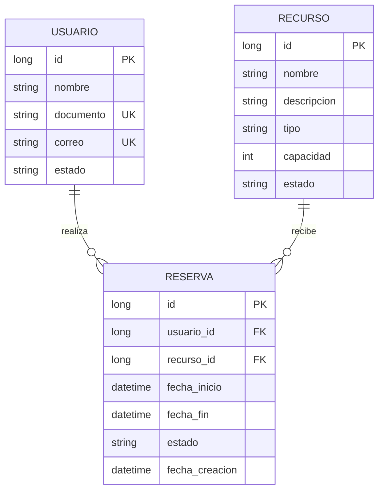

# Data Model: Reservas y disponibilidad

## Reserva

| Campo | Tipo Java | Columna | Restricciones |
|---|---|---|---|
| id | `Long` | `id` | PK, autoincremental |
| usuario | `Usuario` | `usuario_id` | FK, `nullable=false`, `ManyToOne(LAZY)` |
| recurso | `Recurso` | `recurso_id` | FK, `nullable=false`, `ManyToOne(LAZY)` |
| fechaInicio | `LocalDateTime` | `fecha_inicio` | `nullable=false` |
| fechaFin | `LocalDateTime` | `fecha_fin` | `nullable=false`, `> fecha_inicio` |
| estado | `EstadoReserva` | `estado` | `nullable=false`, `EnumType.STRING`, `length=20` |
| fechaCreacion | `LocalDateTime` | `fecha_creacion` | `nullable=false`, `updatable=false` |

### Enum `EstadoReserva`

```java
ACTIVA,
CANCELADA,
FINALIZADA
```

### Reglas

- Al crear: `estado = ACTIVA`, `fechaCreacion = now`.
- `fechaFin > fechaInicio`.
- `fechaInicio >= now` al crear.
- Solo `ACTIVA` bloquea solapamientos.
- `CANCELADA` y `FINALIZADA` no bloquean.
- `FINALIZADA` no se puede cancelar.
- Una reserva `ACTIVA` con `fechaFin <= now` se considera finalizada.

## Relaciones



## Índices

```sql
CREATE INDEX idx_reserva_recurso_estado_fechas
    ON reservas (recurso_id, estado, fecha_inicio, fecha_fin);

CREATE INDEX idx_reserva_usuario_estado
    ON reservas (usuario_id, estado);
```

## DDL de referencia

```sql
CREATE TABLE reservas (
    id BIGINT GENERATED BY DEFAULT AS IDENTITY PRIMARY KEY,
    usuario_id BIGINT NOT NULL,
    recurso_id BIGINT NOT NULL,
    fecha_inicio TIMESTAMP NOT NULL,
    fecha_fin TIMESTAMP NOT NULL,
    estado VARCHAR(20) NOT NULL,
    fecha_creacion TIMESTAMP NOT NULL,
    CONSTRAINT fk_reserva_usuario FOREIGN KEY (usuario_id) REFERENCES usuarios (id),
    CONSTRAINT fk_reserva_recurso FOREIGN KEY (recurso_id) REFERENCES recursos (id),
    CONSTRAINT chk_reserva_fechas CHECK (fecha_fin > fecha_inicio)
);
```

Hibernate genera el esquema con `ddl-auto=create-drop`; el DDL anterior es de referencia.

## Consultas clave

### Solapamiento

```text
estado = ACTIVA
AND fecha_inicio < :fechaFin
AND fecha_fin > :fechaInicio
```

### Reservas activas vigentes por usuario

```text
usuario_id = :usuarioId
AND estado = ACTIVA
AND fecha_fin > :now
```

### Reservas por fecha

```text
fecha_inicio < :finDelDia
AND fecha_fin > :inicioDelDia
```

### Finalización

```text
estado = ACTIVA
AND fecha_fin <= :now
→ estado = FINALIZADA
```
